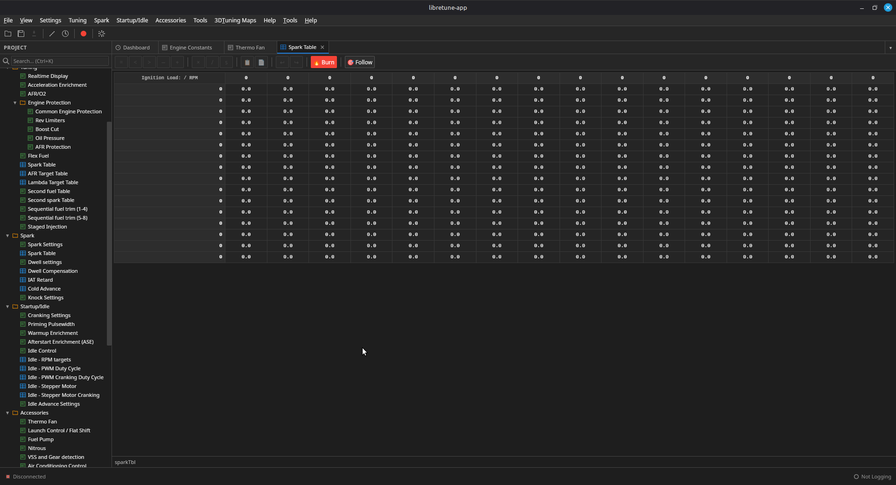

# Редактирование таблиц

LibreTune предоставляет инструменты для редактирования калибровочных таблиц ЭБУ.

## Обзор

Калибровочные данные ЭБУ хранятся в таблицах:
- **1D-таблицы** — одна строка значений (например, обогащение при прогреве в зависимости от температуры).
- **2D-таблицы** — сетка значений, индексируемая двумя осями (например, таблица VE по оборотам и MAP).

## Открытие таблицы

1. Найдите нужный раздел в дереве меню боковой панели.
2. Нажмите на название таблицы (например, **Топливо → VE Table 1**).
3. Редактор таблицы откроется в новой вкладке.

## Интерфейс редактора

| Область | Назначение |
|---|---|
| **Панель инструментов** | Операции редактирования и параметры отображения |
| **Подписи осей** | RPM (столбцы) и нагрузка/MAP (строки) |
| **Сетка ячеек** | Редактируемые значения |
| **3D-вид** | Дополнительная трёхмерная визуализация |

## Выбор ячеек

| Действие | Результат |
|---|---|
| Щелчок | Выбрать одну ячейку |
| Shift+щелчок | Расширить выделение |
| Ctrl+щелчок | Добавить ячейку в выделение или убрать её |
| Щелчок и перетаскивание | Выделить прямоугольную область |
| Ctrl+A | Выделить все ячейки |

## Изменение значений

### Ввод значения напрямую

1. Выберите ячейку.
2. Введите новое значение.
3. Нажмите Enter для подтверждения.

### Увеличение и уменьшение

- Нажмите `+` или `>` для увеличения на шаг.
- Нажмите `-` или `<` для уменьшения на шаг.
- Удерживайте Shift, чтобы увеличить шаг в 10 раз.

### Групповые операции

Полный список приведён в разделе [Сочетания клавиш](./table-editing/shortcuts.md).

| Клавиша | Операция |
|---|---|
| `=` | Задать выделенным ячейкам их среднее значение |
| `*` | Умножить выделенные значения на коэффициент |
| `/` | Интерполировать значения между угловыми ячейками |
| `S` | Сгладить выделенные ячейки |

## Операции на панели инструментов

### Задать одинаковое значение (`=`)

Заменяет значения всех выделенных ячеек их средним значением.

### Масштабирование (`*`)

Умножает выделенные ячейки на заданный коэффициент:
- `1.1` — увеличить значения на 10 %.
- `0.9` — уменьшить значения на 10 %.

### Сглаживание (`S`)

Применяет гауссово сглаживание, уменьшая резкие перепады между соседними значениями. Чем выше коэффициент, тем сильнее смешиваются значения.

### Интерполяция (`/`)

Создаёт плавный переход между угловыми значениями:
1. Выделите прямоугольную область.
2. Нажмите `/`.
3. Значения будут рассчитаны методом билинейной интерполяции.

### Переразбиение (Re-bin)

Изменяет значения осей и автоматически интерполирует значения Z. Это удобно при изменении точек оборотов или нагрузки.

## Копирование и вставка

- `Ctrl+C` — скопировать выделенные ячейки.
- `Ctrl+V` — вставить значения.
- `Ctrl+Shift+V` — вставить с дополнительными параметрами (сложение, умножение и т. п.).

## Импорт и экспорт таблиц (.table)

Отдельные таблицы можно сохранять в файлы `.table`, совместимые с TunerStudio, и загружать из них. Это удобно для переноса одной таблицы (например, VE, карты зажигания или времени задержки форсунок) между проектами без изменения остальной калибровки.

- **Сохранить таблицу в файл** — кнопка загрузки на панели таблицы сохраняет текущие значения осей X/Y и сетку значений в файл `.table`.
- **Загрузить таблицу из файла** — кнопка импорта считывает файл `.table` в открытую таблицу, заменяя её оси и значения.

Особенности:
- Файлы `.table` совместимы с командами TunerStudio «Save Table to File» и «Load Table from File».
- Размерность файла должна точно совпадать с текущим размером таблицы. В отличие от TunerStudio, LibreTune не пересчитывает сетку другого размера на текущие оси. Сначала измените размер таблицы через Re-bin.
- Импорт заменяет оси и значения выбранной таблицы; остальные данные калибровки не меняются. Когда результат вас устроит, выполните запись в ЭБУ (Burn).

## Отмена и повтор действий

- `Ctrl+Z` — отменить последнее изменение.
- `Ctrl+Y` или `Ctrl+Shift+Z` — повторить отменённое действие.

## Направление оси Y

По умолчанию ось Y (нагрузка) начинается сверху таблицы и увеличивается вниз. Нажмите кнопку **Ось Y** на панели инструментов (значок со стрелками), чтобы перевернуть направление: минимальная нагрузка окажется внизу, как на обычном графике. Этот же параметр доступен в **Настройки → Отображение таблиц → Нулевая отметка оси Y внизу**. Он применяется ко всем таблицам и сохраняется между запусками.

## Режим Follow

Включите **Follow Mode**, чтобы автоматически подсвечивать ячейку, соответствующую текущему режиму работы двигателя:
1. Подключитесь к ЭБУ.
2. Нажмите значок перекрестия на панели инструментов.
3. Текущая рабочая ячейка будет подсвечена.

Дополнительно поверх подсветки отображается линия следа по недавно посещённым ячейкам. Она заканчивается яркой точкой в текущей ячейке и позволяет быстро увидеть, в какой области таблицы работает двигатель. Линия отображается как в отдельном окне таблицы, так и в таблицах внутри диалогов.

- Старые участки постепенно исчезают; длительность задаётся параметром *Trail fade* (`table_trail_fade_sec`, значение 0 отключает исчезновение).
- Положение определяется по каналам осей самой таблицы. Если INI не задаёт их, используются стандартные каналы `rpm` и `map`.
- Режим переключается клавишей `F`; цвета курсора и следа задаются параметрами *Cursor color* и *Trail color*.

## Редактирование кривых

Одномерные кривые (например, обогащение при прогреве или PWM вентилятора в зависимости от температуры) открываются в редакторе кривых. В нём график с перетаскиваемыми точками расположен рядом с таблицей данных.

- **Перетаскивание:** нажмите на график рядом с точкой и перемещайте её вверх или вниз. Можно также перетаскивать сам маркер точки. Перемещение продолжается, даже если курсор выходит за пределы графика; изменение фиксируется после отпускания кнопки мыши.
- **Точный ввод:** дважды щёлкните ячейку таблицы данных и введите нужное число.
- **Отмена и повтор:** `Ctrl+Z` и `Ctrl+Y` работают так же, как в редакторе таблиц.

## Далее

- [2D-таблицы](./table-editing/2d-tables.md) — подробное редактирование двумерных таблиц.
- [3D-визуализация](./table-editing/3d-visualization.md) — работа с трёхмерным видом.
- [Сочетания клавиш](./table-editing/shortcuts.md) — полный список комбинаций.
