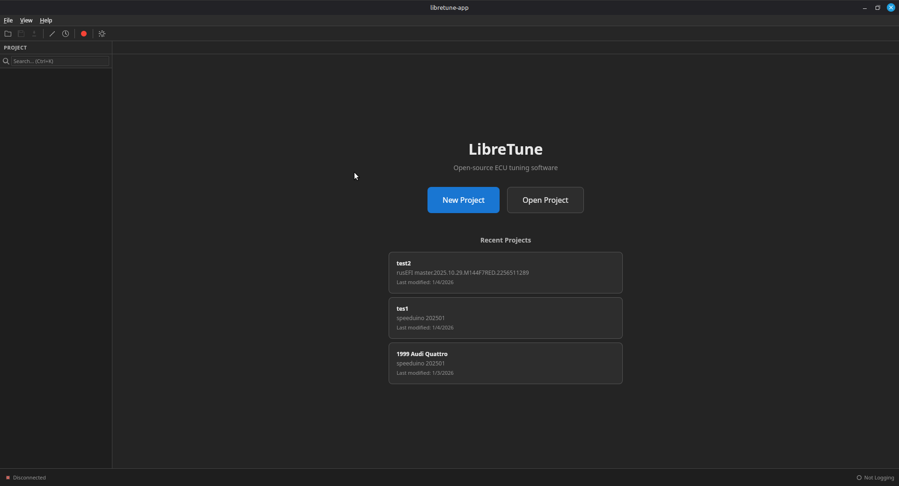

# Введение

Добро пожаловать в **LibreTune** — современную программу с открытым исходным кодом для настройки ЭБУ Speeduino, epicEFI, rusEFI и других совместимых систем управления двигателем.

## Что такое LibreTune?

LibreTune — настольное приложение, которое позволяет:

- **Подключаться** к ЭБУ через последовательный USB-порт.
- **Контролировать** параметры двигателя в реальном времени с помощью настраиваемых панелей приборов.
- **Редактировать** таблицы топлива, зажигания и другие калибровочные таблицы.
- **Выполнять AutoTune** — автоматическую настройку двигателя по данным широкополосного датчика AFR.
- **Сохранять и управлять** несколькими версиями калибровок с историей изменений на основе Git.
- **Записывать данные** для последующего анализа и воспроизведения.

## Основные возможности

### Современный интерфейс

LibreTune предлагает понятный интерфейс с поддержкой тёмной темы, навигацией с клавиатуры и работой на нескольких мониторах.

### Профессиональное редактирование таблиц

Для редактирования двумерных и трёхмерных таблиц доступны профессиональные инструменты:

- операции «Задать одинаковое значение», «Масштабировать», «Сгладить» и «Интерполировать»;
- копирование и вставка с интеллектуальным выбором ячеек;
- переразбиение таблиц с автоматической интерполяцией значений Z;
- трёхмерная визуализация для наглядного анализа данных.

### AutoTune

Автоматическая корректировка VE и других таблиц на основе показаний широкополосного датчика кислорода:

- рекомендации в реальном времени с ограничением степени влияния;
- фильтрация переходных режимов для исключения некорректных данных;
- тепловая карта, показывающая охват настройки.

### Совместимость с TunerStudio

- Импорт существующих проектов TunerStudio.
- Использование стандартных файлов описания INI.
- Импорт макетов панелей приборов TunerStudio.

## Поддерживаемые ЭБУ

LibreTune работает с ЭБУ, использующими стандартный формат описания INI:

- **Speeduino** — все версии.
- **rusEFI** — все варианты плат.
- **epicEFI** — все версии.
- **MegaSquirt** — MS2 и MS3 (режим совместимости).

## Начало работы

Чтобы приступить к настройке, откройте руководство [Установка](./getting-started/installation.md) и установите LibreTune на свой компьютер.

## Получение помощи

- **Справка в приложении:** нажмите `F1` или кнопку `?` в любом диалоговом окне.
- **GitHub Issues:** [сообщить об ошибке или предложить функцию](https://github.com/RallyPat/LibreTune/issues).
- **Сообщество:** обсуждения доступны в репозитории GitHub.

## Лицензия

LibreTune — программное обеспечение с открытым исходным кодом, распространяемое по лицензии [GPL-2.0](https://github.com/RallyPat/LibreTune/blob/main/LICENSE).
